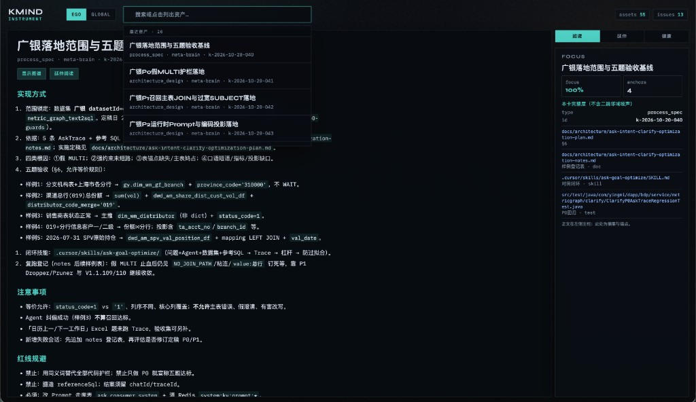
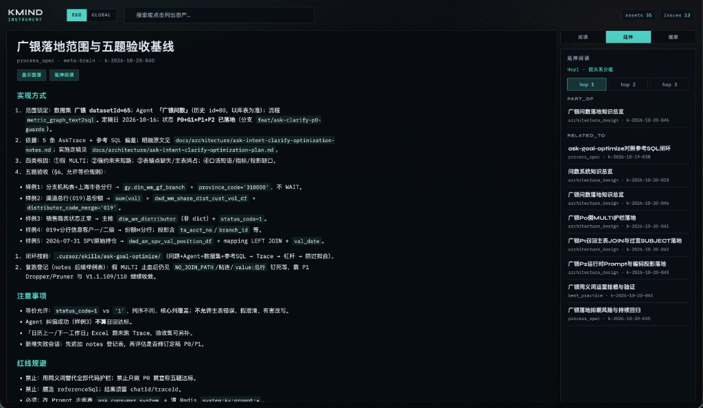
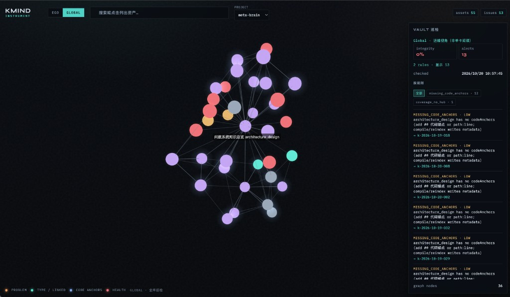

# KMind

**你的 AI 编程工具会忘记一切，KMind 不会。**

Local-first, AI-native knowledge compounding system.  
Unify Claude Code, Cursor, Qoder, Codex & Kiro sessions into a queryable knowledge graph via MCP.

[](https://nodejs.org)
[](LICENSE)
[](https://modelcontextprotocol.io)
[](https://github.com/VinderDiesel/KMind)

---

## 目录

1. [问题与定位](#问题与定位)
2. [核心特性](#核心特性)
3. [快速开始](#快速开始)
4. [团队共享知识库](#团队共享知识库)
5. [知识初始化 Bootstrap](#知识初始化-bootstrap)
6. [Agent 日常工作流](#agent-日常工作流)
7. [质量闸门](#质量闸门)
8. [架构概览](#架构概览)
9. [CLI 命令](#cli-命令)
10. [MCP 工具](#mcp-工具)
11. [知识资产类型](#知识资产类型)
12. [数据存储](#数据存储)
13. [本地知识 UI](#本地知识-ui)
14. [自动整理 Schedule](#自动整理-schedule)
15. [Monorepo 与适配器](#monorepo-与适配器)
16. [开发](#开发)
17. [文档索引](#文档索引)
18. [Roadmap](#roadmap)

---

## 问题与定位

你花两小时在 Claude Code 里解决了 PostgreSQL advisory lock 死锁。三周后在 Cursor 里再遇到类似场景，又从零开始。

| 痛点 | 表现 |
|:---|:---|
| 知识随会话消亡 | 每次 AI 编程会话都在产生知识，绝大多数被丢弃 |
| 知识孤岛 | Claude Code 的架构决策，Cursor 不知道；Codex 的踩坑，Qoder 无法访问 |
| 数据主权缺失 | 多数方案把知识锁在云端，无法导出、无法审计 |
| 假完整 | Agent 写一张总览就宣称「系统整理完」 |

**KMind**：本地优先、多终端统一、AI 原生的知识复利系统。  
智能飞轮：**聪明写入 → 结构化召回 → 可度量进化**（见 [ADR-002](docs/adr/002-intelligence-flywheel.md)）。  
首次整理靠确定性 Bootstrap × Agent 深挖，**禁止自动灌知识正文**；是否完整只认 `kmind_coverage`（见 [ADR-004](docs/adr/004-knowledge-bootstrap-hybrid.md)）。

---

## 核心特性

| 特性 | 说明 |
|:---|:---|
| **多终端插件式接入** | Adapter 接入 Claude Code、Cursor、Qoder、Codex、Kiro；新增终端通常少于 200 行 |
| **MCP + Skills 原生** | `adapters install` 写入 MCP；`kmind-capture` / `kmind-code-bridge` Skills 全局或仓内安装 |
| **团队项目 Vault** | `kmind init --project` → `.kmind-knowledge/`；知识随 git 流动；hooks 自动 reindex |
| **Bootstrap 知识初始化** | 确定性扫仓 → DigGroup/DigTask → DigPacket 委托深挖；进度可 resume；**不**自动 capture |
| **九类知识资产** | problem / outcome / problem_solution / best_practice / architecture_design / tool_usage / pitfall / code_snippet / process_spec |
| **知识图谱 + 本体** | 实体 / 概念 / 关系；本体 Schema 可扩展；双图边界见 [ADR-003](docs/adr/003-dual-graph-boundary.md) |
| **混合检索 + Context Pack** | 全文 + 结构化 + 图谱 + 向量；`kmind_pack` 主卡+邻域+锚点 |
| **Coverage 验收** | 整理某系统后必须 `kmind_coverage`；仅 `complete=true` 可宣称完整 |
| **数据本地化** | Markdown + SQLite，零云端依赖；个人 `~/.kmind` 或项目 `.kmind-knowledge/` |
| **导出 / 导入** | `tar.gz` 或 git 目录；merge + 冲突策略 |
| **本地只读 UI** | `kmind ui`：Ego 阅读 / Global 巡检 |

---

## 快速开始

### 环境要求

- Node.js **20+**
- [pnpm](https://pnpm.io) **9+**（本仓库 pnpm workspace；当前 `packageManager` 为 pnpm 12）

### 从源码安装（当前推荐）

```bash
git clone https://github.com/VinderDiesel/KMind.git
cd KMind
pnpm install
pnpm build
```

`pnpm build`（以及已有 `dist` 时的 `pnpm install`）会把 CLI 链到全局：

- 符号链接：`~/.local/bin/kmind` → `packages/cli/dist/index.js`
- 并尽量执行 `pnpm link --global`（`@kmind/cli`）

```bash
kmind --help
kmind init              # 个人 Vault：~/.kmind
kmind init --project    # 团队：仓库内 .kmind-knowledge/ + AGENTS 合并 + git hooks
```

找不到命令时，把 `~/.local/bin` 加入 PATH：

```bash
echo 'export PATH="$HOME/.local/bin:$PATH"' >> ~/.zshrc && source ~/.zshrc
```

仓库内也可用：`pnpm kmind <command>` 或 `pnpm link:cli`。

### Vault 解析顺序

1. `--vault <path>`
2. 向上查找 `.kmind-knowledge/config.yaml`
3. 回退 `~/.kmind`

### 接入 AI 终端（MCP + Skills）

```bash
kmind adapters list

# 个人：写入该终端 MCP + Skills（全局 ~/.…/skills）
kmind adapters install cursor

# 团队仓：钉死项目 vault（Cursor → <repo>/.cursor/mcp.json）
kmind init --project
kmind adapters install cursor --project

kmind adapters install claude-code
kmind adapters install qoder
kmind adapters install codex
kmind adapters install kiro

# Skills 批量 / 仅仓内
kmind skills install --all
kmind skills install cursor --project   # 合并 AGENTS.md / CLAUDE.md / copilot-instructions
```

装完后**重启终端或 Reload Window**，用 `kmind_status` 确认 `vaultPath` 指向预期 vault。  
不加 `--project` 时 MCP 常因 cwd 落到 `~/.kmind`；`project=` 过滤 ≠ vault 隔离。

### 启动 MCP（可选）

日常由 IDE **按需拉起** stdio，一般不必常驻。

```bash
kmind mcp-serve --daemon          # 后台 HTTP → http://127.0.0.1:7822/mcp
kmind mcp-serve --status
kmind mcp-serve --stop
kmind mcp-serve --http            # HTTP 前台
kmind mcp-serve --stdio           # stdio 前台
```

手动 MCP 配置示例（路径按本机调整）：

```json
{
  "mcpServers": {
    "kmind": {
      "command": "node",
      "args": ["/absolute/path/to/KMind/packages/cli/dist/index.js", "mcp-serve"]
    }
  }
}
```

### 开始对话

> 「搜索我之前关于 PostgreSQL 死锁的踩坑」  
> 「把这次架构决策沉淀到 KMind」  
> 「用 bootstrap 盘点这个仓库，按组 delegate 深挖」

CLI 示例：

```bash
kmind capture "PostgreSQL advisory lock 死锁，改用 Redis" --type pitfall --title "advisory lock 死锁"
kmind search "advisory lock"
kmind pack --id k-2026-10-19-001
kmind coverage --project my-app
```

---

## 团队共享知识库

解决「同仓多人各自踩坑、重复造轮子 / 重复建相似表」：知识进业务仓，随 `git pull` / PR 共享。

```bash
# 业务仓根（需已是 git 仓库）
kmind init --project
git add .kmind-knowledge AGENTS.md CLAUDE.md .githooks .github/copilot-instructions.md
git commit -m "chore: add team KMind project vault"
```

**进 git**：`knowledge/`、`ontology/`、`asset-types/`、`config.yaml`、`FEATURE_TREE.md`、`.gitignore`  
**禁止进 git**：`raw/`、`index.db`、`audit/`、会话全文、密钥

| 行为 | 谁做 | 说明 |
|:---|:---|:---|
| 查知识 | Agent / MCP | 写模块前 `kmind_pack`；须 `adapters install … --project` 钉死 vault |
| 拉同事知识 | `git pull` | hooks：`post-merge` / `post-checkout` → `reindex` |
| 沉淀 | Agent 定案后 capture | 落盘 `knowledge/`；`pre-commit` stage 允许路径 |
| 推送 | 照常 `git push` | **不**静默 push |

资产 id：`k-YYYY-MM-DD-NNN-<4hex>`（可用 `KMIND_AUTHOR` 固定后缀）。  
`FEATURE_TREE.md` 在 vault 根维护（`init --project` / `feature-tree ensure`），整理时对照 `todo`→`done`+资产 id。

验收：[docs/TEAM_VAULT_ACCEPTANCE.md](docs/TEAM_VAULT_ACCEPTANCE.md)。Agent 全局规范：根目录 [AGENTS.md](AGENTS.md)。

---

## 知识初始化 Bootstrap

面向「整理某系统 / 全项目首次盘点」。工程负责清单，Agent 负责深挖；**Bootstrap / DigPacket ≠ complete**。

```text
preview → apply-tree（可选）→ 按组 delegate → dig + capture → mark → coverage
```

```bash
# 预览 DigGroup / DigTask（只读）
kmind bootstrap preview --project my-app --repo .

# 写入 FEATURE_TREE 的 bootstrap 区（todo，不 capture）
kmind bootstrap apply-tree --project my-app --repo .

# 列出组 / 输出单组 DigPacket（给宿主 Agent）
kmind bootstrap delegate --project my-app --repo .
kmind bootstrap delegate --project my-app --repo . --group packages/core --json

# 进度与标记
kmind bootstrap status --project my-app
kmind bootstrap mark --project my-app --task dig-… --status done --asset k-…
kmind bootstrap sync-tree --project my-app --repo .   # 按 progress 幂等同步树

# capture 成功时可自动 mark
kmind capture "…" --type architecture_design --bootstrap-task dig-…
```

| 能力 | 说明 |
|:---|:---|
| 规则 overlay | vault `bootstrap-rules.yaml`（`init --project` 幂等模板；不存在则内置启发式；first-match） |
| 进度 | `audit/bootstrap-progress.json`（勿提交 git） |
| 锚点 | 路径级 + 可选 Codegraph 导出符号；不持久化 callers |
| 可选 LLM | `config.yaml` 中 `bootstrap.llmGrouping` / `llmPlan`（默认关；本地 Ollama 风格，失败回退） |
| Evolution | `todo` DigTask → 队列 `source=bootstrap`（含 `digTaskId` / `groupLabel`） |
| Delegate 列表 | 返回 `recommendedNext` + `stats`；MCP `kmind_capture.bootstrapTask` 成功后自动 mark |

MCP：`kmind_bootstrap_preview` / `status` / `mark` / `delegate`；capture 可带 `bootstrapTask`。细则：[ADR-004](docs/adr/004-knowledge-bootstrap-hybrid.md) M3、Skill `kmind-capture` Delegate 模式。

---

## Agent 日常工作流

| 场景 | 顺序 |
|:---|:---|
| **写代码前** | `kmind_pack` / `kmind_search`（防重复造轮子 / 重复建表） |
| **定案后** | `kmind_capture_suggest` → 人确认 → `kmind_capture`（用户不必说「记一下」） |
| **首次整理系统** | bootstrap preview → 按组 delegate → 深挖 capture → mark → **coverage** |
| **查代码结构** | Codegraph（`codegraph_explore`）；决策/踩坑仍走 KMind（ADR-003） |

Skills：`kmind-capture`、`kmind-code-bridge`（仓库 `skills/`；`adapters install` / `skills install` 分发）。

---

## 质量闸门

写入侧防污染，验收侧防假完整：

1. **Session 双闸门**：`compileSessions=false` 且未设 `KMIND_COMPILE_SESSIONS=1` 时，`raw/sessions/` **永不**升知识  
2. **管线质量闸**：明细 + 一卡一事 + 禁止 `project=global`；架构/流程须**代码锚点**  
3. **增量默认挂图**：project 已有资产时，capture 须 `related` / `links` 接到总览或邻卡  
4. **Coverage**：仅 `complete=true` / `claimCompleteAllowed=true` 可宣称整理完毕；断锚点、过期卡否决 complete  
5. **Bootstrap 红线**：不自动生成知识正文；delegate 输出不能当 complete  

```bash
kmind lint
kmind coverage --project my-app
kmind purge-sessions --dry-run
kmind evolution scan
kmind evolution status
```

---

## 架构概览

```
┌─────────────────────────────────────────────────────────────┐
│                   AI 编程终端层                              │
│  Claude Code │ Cursor │ Qoder │ Codex │ Kiro │ ...          │
└──────────────────────┬──────────────────────────────────────┘
                       │ MCP / Skills
┌──────────────────────┼──────────────────────────────────────┐
│                 KMind Core Engine                            │
│  MCP Server · Adapter Registry · Bootstrap · Compiler        │
│  Query (search/pack) · Evolution · Coverage · Health         │
│  Storage: Markdown (SoT) + SQLite (rebuildable) + Ontology   │
└──────────────────────────────────────────────────────────────┘
```

### 三层数据模型

| 层 | 职责 | 可变性 |
|:---|:---|:---|
| **Raw** | 原始会话、文章、PDF、代码快照 | 不可变事实基准 |
| **Knowledge** | 知识资产页 + 实体/概念 + 双向链接 | 可审核、可演化 |
| **Index** | SQLite FTS + 向量 + 图谱 | `kmind reindex` 可重建 |

分层：`cli` / `mcp-server` / `ui` → `@kmind/core` → Vault；adapters 仅依赖公开接口。  
详见 [docs/ARCHITECTURE.md](docs/ARCHITECTURE.md)。

---

## CLI 命令

全局选项：`--vault <path>`、`--json`。

| 命令 | 说明 |
|:---|:---|
| `kmind init` | 初始化 Vault；`--project` 建仓内 vault |
| `kmind feature-tree` | `FEATURE_TREE.md` 确保 / 维护 |
| `kmind bootstrap …` | 知识初始化：`preview` / `apply-tree` / `sync-tree` / `status` / `mark` / `delegate` |
| `kmind compile` | 将 raw 会话编译为知识资产（仍受 Session 双闸门约束） |
| `kmind search <query>` | 混合检索（精确 id 可直接命中） |
| `kmind pack [query] --id <id>` | Context Pack（主卡+邻域+锚点） |
| `kmind suggest-capture <content>` | 写入建议（不落库） |
| `kmind capture <content>` | 手动捕获（`--related` / `--anchors` / `--bootstrap-task`） |
| `kmind purge-sessions` | 删除 session 编译资产（保留 manual + raw） |
| `kmind expiry …` | 过期卡：`list` / `deprecate` / `supersede` / `refresh` / `deprecate-all` |
| `kmind lint` | 健康检查 |
| `kmind coverage --project <p>` | 覆盖率验收；`complete=false` 禁止宣称完整 |
| `kmind evolution scan\|status\|ack` | 进化队列（coverage+lint；只诊断不自动写） |
| `kmind export` / `kmind import` | 导出 / 导入（`tar.gz` 或 git；merge + 冲突策略） |
| `kmind reindex` | 从 Markdown 重建 SQLite |
| `kmind mcp-serve` | MCP：IDE 用 stdio；`--daemon` 后台 HTTP |
| `kmind ui` | 本地只读知识 UI（`127.0.0.1:7821`） |
| `kmind adapters list\|install` | 适配器与 MCP 配置 |
| `kmind skills install` | 安装 Agent Skills |
| `kmind schedule …` | 按 adapter cron 自动整理 |
| `kmind hook <event>` | 生命周期 Hook |

---

## MCP 工具

| 工具 | 级别 | 说明 |
|:---|:---|:---|
| `kmind_search` | read | 混合检索 |
| `kmind_pack` | read | Context Pack |
| `kmind_get` | read | 按 id 取单卡 |
| `kmind_related` | read | 图谱关联 |
| `kmind_status` | read | Vault 健康 |
| `kmind_ontology_describe` | read | 本体结构 |
| `kmind_capture_suggest` | read | 写入建议（确认后回灌 capture） |
| `kmind_capture` | write | 手动捕获（质量闸；可选 `bootstrapTask`） |
| `kmind_coverage` | read | 深度 vs 目录验收 |
| `kmind_bootstrap_preview` | read | 初始化计划 `BootstrapPlan` |
| `kmind_bootstrap_status` | read | Dig 进度 |
| `kmind_bootstrap_mark` | write | 标记 DigTask（不 capture） |
| `kmind_bootstrap_delegate` | read | DigPacket / 组列表 |
| `kmind_evolution_queue` | read | 进化待办 |
| `kmind_problem_status` | read | 问题闭环（solves + verifies） |
| `kmind_graph_query` | sensitive | 类 Cypher 图谱查询 |
| `kmind_export` / `kmind_import` | sensitive | 导出 / 导入 |

完整参数与约定：[docs/MCP_TOOLS.md](docs/MCP_TOOLS.md)。

---

## 知识资产类型

| 类型 | 时机 | 示例 |
|:---|:---|:---|
| `problem` | 可跟踪未解问题 | JOIN 路径丢失 → NO_JOIN_PATH |
| `outcome` | 方案落地验证 | 样例 AskTrace 已通过 |
| `problem_solution` | 可执行方案（`links.solves`） | 改投影策略 |
| `best_practice` | 可复用约定 | 异步任务必须超时与重试上限 |
| `architecture_design` | 架构决策 | 事件驱动 vs 请求-响应 |
| `tool_usage` | 工具配置/技巧 | `.cursorrules` 声明测试命令 |
| `pitfall` | 重复踩坑 | Windows 下 MCP 路径解析异常 |
| `code_snippet` | 可复用实现 | 指数退避重试 |
| `process_spec` | 团队流程 | 提交前 lint + typecheck + 单测 |

问题闭环：`solution -[:solves]-> problem`，`outcome -[:verifies]-> problem`；`kmind_problem_status` 看 open / addressed / verified。  
类型注册与覆盖：[ADR-001](docs/adr/001-asset-type-registry.md)。

---

## 数据存储

```
~/.kmind/   或项目 `.kmind-knowledge/`
├── knowledge/           # 知识资产（Markdown，源真相）
│   ├── projects/
│   └── global/
├── raw/                 # 原始会话（不可变；勿 git）
├── ontology/
│   └── ontology.yaml
├── asset-types/         # 类型覆盖（可选 YAML）
├── FEATURE_TREE.md      # 功能/模块盘点树（项目 vault）
├── bootstrap-rules.yaml # 可选 Bootstrap 路径规则
├── index/               # SQLite（可重建；勿 git）
├── audit/               # 本地可观测（勿 git）
│   ├── YYYY-MM-DD.jsonl
│   ├── search-queries/
│   ├── bootstrap-progress.json
│   └── evolution-queue.json
└── config.yaml
```

每次 `search` / `pack`（CLI、MCP、UI）会在当前 vault 的 `audit/search-queries/` 追加 JSONL。

```bash
kmind export --output backup.tar.gz
kmind import --input backup.tar.gz
```

---

## 本地知识 UI

```bash
pnpm build
kmind ui
# kmind ui --focus k-2026-01-01-001
```

- 绑定 `127.0.0.1`，API 只读  
- **Ego**：阅读 / 延伸 / 健康·覆盖；图谱按需（默认 hop=1）  
- **Global**：全库巡检台  
- `kmind reindex` 回填 `metadata.codeAnchors`

#### 界面示例

**Ego · 阅读**：主栏 Markdown；侧栏 Focus 完整度与代码锚点。



**Ego · 延伸**：按关系列出 Hop1 邻居，点击换焦点。



**Global · 巡检**：全库图谱 + Vault 健康告警。



---

## 自动整理 Schedule

按 **每个 adapter** 配置 5 字段 cron；`kmind schedule start` 轮询到期后执行：

`capture(raw) → compile → lint → reindex`

**不会绕过 Session 双闸门**（默认不把 `raw/sessions/` 升成 knowledge）。

```yaml
# ~/.kmind/config.yaml 或项目 vault config.yaml
adapters:
  cursor:
    enabled: true
    schedule: "0 */6 * * *"
  claude-code:
    enabled: true
    schedule: "0 2 * * *"
schedule:
  enabled: true
  tickSeconds: 30
```

```bash
kmind schedule set cursor --cron "0 */6 * * *"
kmind schedule list
kmind schedule run --adapter cursor --force
kmind schedule start --daemon
kmind schedule status
kmind schedule stop
```

状态与日志在 vault `audit/`（`schedule.pid` / `schedule.log` / `schedule-state.json`）。

---

## Monorepo 与适配器

| 包 | 说明 |
|:---|:---|
| `@kmind/cli` | 命令行入口 |
| `@kmind/core` | 存储 / 本体 / 编译 / 检索 / bootstrap / 健康 |
| `@kmind/mcp-server` | MCP Server |
| `@kmind/shared` | 共享类型与 Zod schema |
| `@kmind/adapter-*` | Claude Code / Cursor / Qoder / Codex / Kiro |
| `@kmind/ui` | 本地只读 Web UI |

实现 `Adapter` 即可接入新终端：

```typescript
export class MyAdapter implements Adapter {
  name = 'my-terminal';
  version = '1.0.0';

  async detect(): Promise<boolean> { /* ... */ }
  async getSessionPaths(): Promise<string[]> { /* ... */ }
  async parseSession(path: string): Promise<SessionRecord> { /* ... */ }
  getMcpConfig(): McpConfigTemplate { /* ... */ }
}
```

详见 [docs/ADAPTER_GUIDE.md](docs/ADAPTER_GUIDE.md)。

---

## 开发

```bash
git clone https://github.com/VinderDiesel/KMind.git
cd KMind
pnpm install
pnpm build
pnpm test
pnpm typecheck
```

技术栈：TypeScript · Node.js 20+ · pnpm monorepo · SQLite（`node:sqlite`）· MCP SDK · Zod · Vitest  

提交前：`pnpm test && pnpm typecheck`。约定见 [CONTRIBUTING.md](CONTRIBUTING.md)、[AGENTS.md](AGENTS.md)。

---

## 文档索引

| 文档 | 内容 |
|:---|:---|
| [AGENTS.md](AGENTS.md) | Agent / 知识协议 + 编码铁律 |
| [ARCHITECTURE.md](docs/ARCHITECTURE.md) | 架构与模块 |
| [DATA_CONTRACTS.md](docs/DATA_CONTRACTS.md) | 数据契约 |
| [MCP_TOOLS.md](docs/MCP_TOOLS.md) | MCP 工具手册 |
| [ADAPTER_GUIDE.md](docs/ADAPTER_GUIDE.md) | 适配器开发 |
| [TEAM_VAULT_ACCEPTANCE.md](docs/TEAM_VAULT_ACCEPTANCE.md) | 团队 vault 验收 |
| [ADR-001](docs/adr/001-asset-type-registry.md) | 资产类型注册 |
| [ADR-002](docs/adr/002-intelligence-flywheel.md) | 智能飞轮 |
| [ADR-003](docs/adr/003-dual-graph-boundary.md) | 双图边界（KMind × Codegraph） |
| [ADR-004](docs/adr/004-knowledge-bootstrap-hybrid.md) | Bootstrap 混合初始化 |

---

## Roadmap

- [x] M1：核心引擎（存储 + 本体 + 图谱 + MCP Server）
- [x] M2：首个适配器（Claude Code）+ 自动捕获 + 分类
- [x] M3：多终端适配器（Cursor / Qoder / Codex / Kiro）+ Registry
- [x] M4：导出/导入增强 + Git 集成（联邦另开）
- [x] M5：知识健康可视化 + 图谱 UI（`kmind ui`）
- [x] 智能飞轮：pack / suggest-capture / coverage / evolution（ADR-002）
- [x] 团队项目 Vault + FEATURE_TREE + AGENTS 协议
- [x] Bootstrap MVP + 深度升级：规则 / progress / delegate / 可选 LLM（ADR-004）
- [x] Bootstrap M3 闭环：MCP `bootstrapTask` / evolution 跳转 / `recommendedNext` / init 规则模板
- [ ] M4b：多实例联邦
- [ ] Coverage / 锚点生存期深化（symbol survival、pack `anchorImpact` 等）
